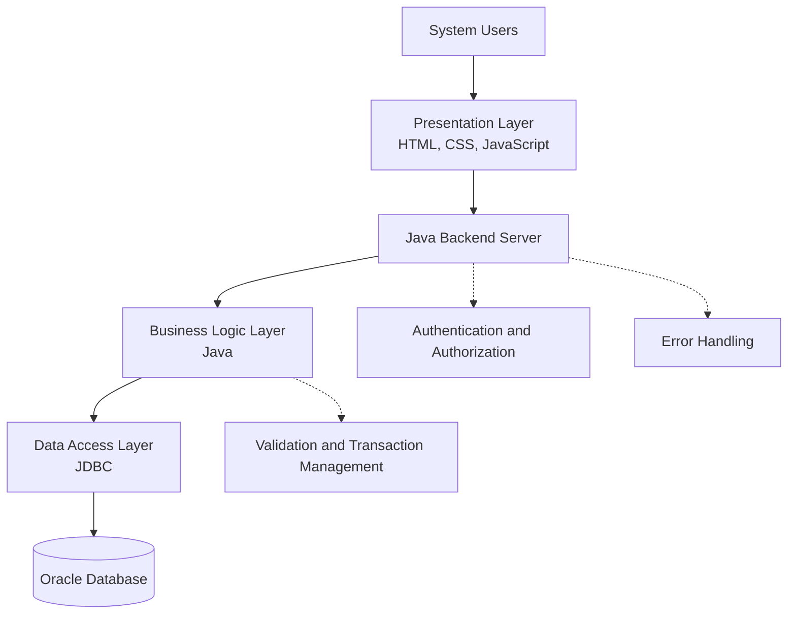

# Inventory and Sales Management System

## Project Overview

The Inventory and Sales Management System (IMS) is a university project designed to manage products, inventory, shops, warehouses, suppliers, purchases, sales, customers, employees, and financial transactions.

The main objective of this project is to simplify inventory operations, improve stock management, reduce manual errors, and maintain accurate business records.

## Technologies Used

| Technology      | Purpose                    |
| --------------- | -------------------------- |
| Java            | Backend Development        |
| HTML            | Frontend Structure         |
| CSS             | User Interface Design      |
| JavaScript      | Frontend Functionality     |
| Oracle Database | Database Management        |
| JDBC            | Java Database Connectivity |
| SQL             | Database Operations        |
| Git             | Version Control            |
| GitHub          | Project Collaboration      |
| VS Code         | Development Environment    |

## System Users

### Administrator

- Manage employees and customers.
- Manage products and categories.
- Manage suppliers, shops, and warehouses.
- Manage purchases and sales.
- Monitor stock levels.
- Manage discounts and payments.
- Monitor system activities.
- View reports.

### Employee

- View products and inventory.
- View available stock.
- Create sales invoices.
- Access authorized system information.

### Customer

- Create an account and log in.
- Browse available products.
- Submit order requests.
- View personal orders.

## Planned System Features

- Role-Based Authentication
- Employee Management
- Customer Management
- Product Management
- Hierarchical Category Management
- Supplier Management
- Shop and Warehouse Management
- Inventory Management
- Purchase Management
- Sales Management
- Stock Transfer
- Stock Capacity Management
- Low Stock Alerts
- Credit Management
- Discount Management
- Payment Management
- Damaged Product Management
- Activity Logging
- Reports and Statistics

## Project Structure

```text
Inventory and Sales Management System/
|
|-- backend/
|   |-- src/
|       |-- Connn.java
|
|-- database/
|   |-- setup.sql
|
|-- frontend/
|
|-- docs/
|
|-- .gitignore
|-- README.md
```

## Database Design

The system uses Oracle Database to store and manage business information. The database schema contains 11 relational tables.

| Table Name      | Description                                     |
| --------------- | ----------------------------------------------- |
| IMS_ACCOUNT     | Stores administrators, employees, and customers |
| IMS_SHOP        | Stores shops and warehouse information          |
| IMS_SUPPLIER    | Stores supplier information                     |
| IMS_CATEGORY    | Manages categories and subcategories            |
| IMS_PRODUCT     | Stores product information and prices           |
| IMS_STOCK       | Manages product quantities and locations        |
| IMS_ORDERS      | Stores purchase and sales transactions          |
| IMS_ORDER_ITEMS | Stores individual order items                   |
| IMS_MOVEMENT    | Records inventory movements and losses          |
| IMS_PAYMENT     | Records financial payments                      |
| IMS_LOG         | Records system activities                       |

## Database Features

- Primary Keys
- Foreign Keys
- Composite Primary Keys
- Identity Columns
- Check Constraints
- Unique Constraints
- Unique Indexes
- Self-Referencing Relationships
- Default Values
- Hierarchical Categories
- Stock Quantity Validation
- Warehouse Uniqueness
- Activity Log Storage

## System Architecture

The project follows a three-layer architecture:

## System Architecture

The system is designed using a layered architecture.




## Installation Requirements

- Java Development Kit (JDK)
- Oracle Database
- Oracle JDBC Driver
- Visual Studio Code
- Git
- Web Browser

## Getting Started

### 1. Clone the Repository

```bash
git clone https://github.com/YamaMayar01/INVENTORY_MANAGEMENT.git
```

### 2. Open the Project

Open the project folder using Visual Studio Code.

### 3. Set Up the Database

Connect to Oracle Database using an authorized database user.

Execute the following script using SQL\*Plus or a compatible script runner:

```text
database/setup.sql
```

Provide a secure administrator password value when prompted. The application must use a compatible password-hashing mechanism before production use.

### 4. Configure Database Connectivity

Configure the Java database connection in:

```text
backend/src/Connn.java
```

Add the Oracle JDBC driver to the Java classpath.

Database credentials must be configured locally and must not be committed to GitHub.

### 5. Run the Application

The complete application startup instructions will be added after the backend and frontend implementations are completed.

## Development Progress

- [x] Project Structure
- [x] Initial Database Connection
- [x] Oracle Database Schema
- [x] Database Tables
- [x] Database Relationships
- [x] Database Constraints
- [x] Database Unique Indexes
- [ ] Authentication System
- [ ] Backend Implementation
- [ ] Frontend Implementation
- [ ] Inventory Operations
- [ ] Purchase and Sales Operations
- [ ] Reporting System
- [ ] System Testing
- [ ] Final Documentation

## Version Control

Git and GitHub are used for source code management and team collaboration.

Each team member works on assigned tasks using separate development branches. Completed changes are reviewed and merged into the main branch through pull requests.

## Project Team

| Name                | Role                    |
| ------------------- | ----------------------- |
| Mohammad Yama Mayar | Team Leader / Developer |
| Ehsanullah Zahirmal | Developer               |
| Shamsulhaq Wesal    | Developer               |
| Dost Mohammad       | Developer               |

## Academic Information

- University: Kandahar University
- Faculty: Computer Science
- Course: Software Engineering and Oracle database
- Project Type: Academic Group Project
- Academic Year: 2026

## Project Status

Currently Under Development

## Purpose

This project is developed for academic and educational purposes to demonstrate practical knowledge of software engineering, Java programming, relational databases, database connectivity, and collaborative software development.
